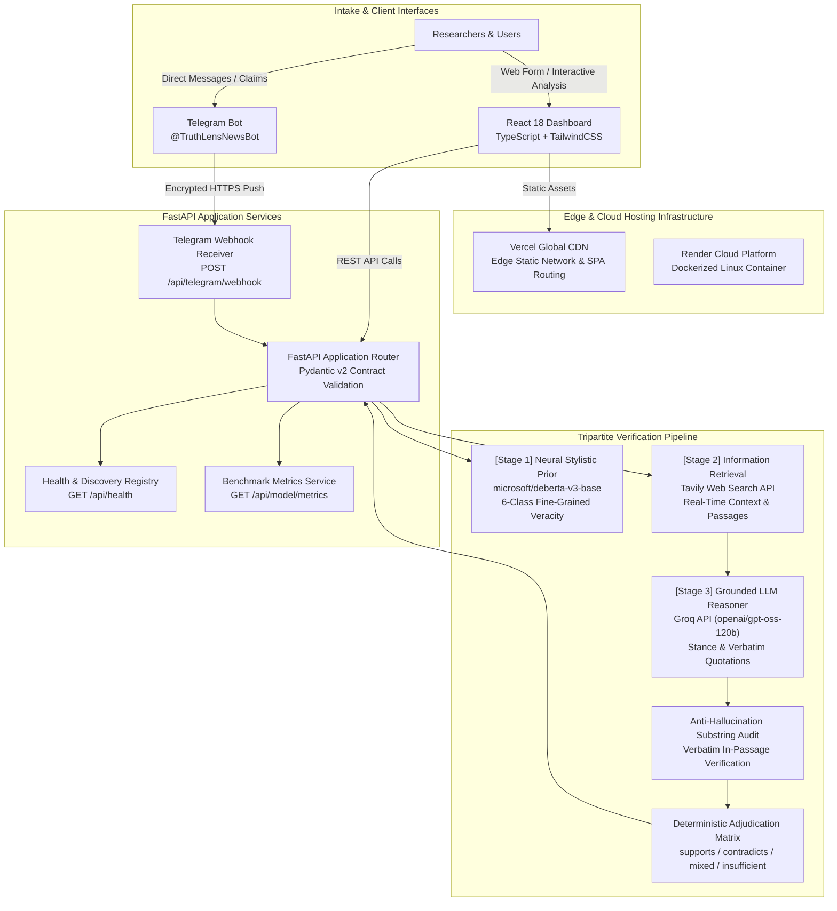
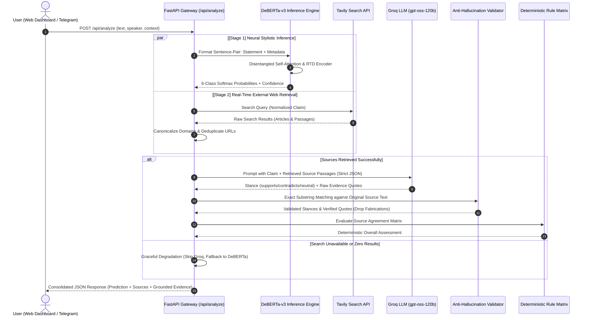
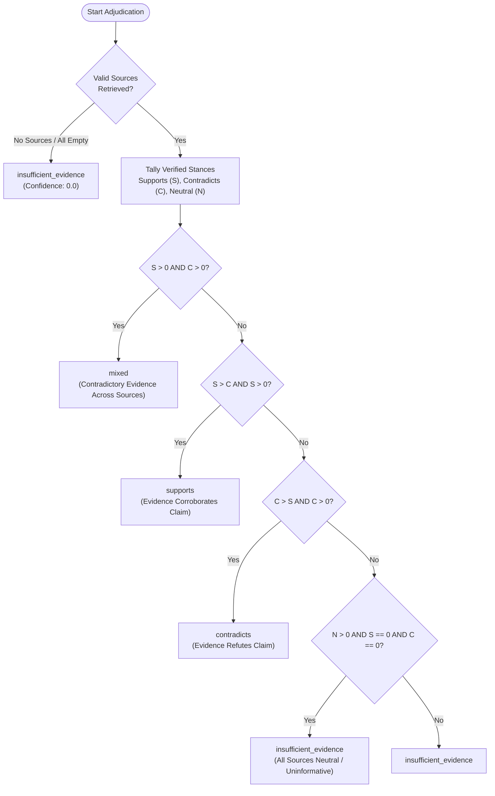

# TruthLens: An NLP-Based Fact-Checking and Robustness Evaluation System

[](https://fastapi.tiangolo.com)
[](https://react.dev)
[](https://www.typescriptlang.org)
[](https://www.python.org)
[](https://huggingface.co/soah-13/truthlens-deberta-v3-liar)
[-F55036.svg?style=flat)](https://groq.com)
[](https://tavily.com)
[](https://docs.pytest.org)
[](https://opensource.org/licenses/MIT)

---

## 1. Executive Summary & Research Motivation

The exponential proliferation of digital misinformation across online social networks presents an urgent computational and societal challenge. While deep language models demonstrate extraordinary syntactic comprehension, standard sequence classifiers applied to automated fact-checking suffer from an **epistemic limitation**:

> *A statement cannot be verified solely by analyzing its linguistic style, rhetoric, or token semantics. Ground truth is inherently extrinsic to the sentence itself.*

To bridge the gap between stylistic classification and real-world ground truth, **TruthLens** introduces an academic research and engineering platform built on a **Tripartite Verification Architecture**:

1. **Neural Stylistic Prior (DeBERTa-v3-base)**: A fine-grained 6-class transformer classifier fine-tuned on the benchmark LIAR dataset with sentence-pair metadata conditioning.
2. **Real-Time External Grounding (Tavily Search API)**: Dynamic, unbiased web retrieval of corroborating journalistic and institutional source passages.
3. **Grounded Evidence Synthesis & Verbatim Verification (Groq LLM)**: Strict source-relative stance evaluation (`supports`, `contradicts`, `neutral`), verbatim anti-hallucination substring validation, and deterministic rule-matrix adjudication.

---

## 2. System Architecture

TruthLens decouples client intake, model inference, real-time web retrieval, LLM reasoning, and cloud deployment into modular, highly resilient subsystems:



---

## 3. End-to-End Verification Pipeline

Every claim submitted to TruthLens undergoes a robust multi-stage analysis pipeline engineered for maximum resilience against external API degradations:



---

## 4. Deterministic Evidence Adjudication Logic

To prevent unconstrained generative hallucinations, TruthLens rejects black-box LLM verdict summaries. Instead, the final evidence classification is synthesized through a **deterministic Python rule matrix**:



### Strict Anti-Hallucination Substring Audit
For every source analyzed by Groq LLM:
1. The LLM returns a proposed `evidence_quote` alongside its stance (`supports`, `contradicts`, or `neutral`).
2. The backend performs a normalized, case-insensitive substring search of `evidence_quote` against the crawled source passage.
3. If the quote cannot be grounded directly in the source text, the quote is immediately stripped to null, and the stance is audited to prevent fabricated rationales.

---

## 5. Benchmark Dataset & Empirical Research Progression

### The LIAR Benchmark (ACL 2017)
TruthLens is benchmarked against the gold-standard **LIAR dataset** (Wang, ACL 2017), consisting of 12,836 real-world political statements collected from PolitiFact:
- **Training Split**: 10,240 statements
- **Validation Split**: 1,284 statements
- **Test Split**: 1,267 statements
- **Target Scale**: Full 6-class fine-grained veracity (`pants-fire`, `false`, `barely-true`, `half-true`, `mostly-true`, `true`).
- **Inherent Task Difficulty**: Human annotator agreement on 6-class political truthfulness is notoriously low (~25% to 30%), due to rhetorical nuance, hyperbole, and partial context.

### Sentence-Pair Metadata Representation
To provide contextual conditioning without altering pretrained transformer vocabularies, metadata is encoded as a structured second sequence:
$$\text{Sequence A} = \text{Statement}$$
$$\text{Sequence B} = \text{"Speaker: } \langle\text{speaker}\rangle \text{ | Context: } \langle\text{context}\rangle\text{"}$$

### Comparative Empirical Benchmarking Results

Across four iterative research experiments, we systematically evaluated model scaling, regularization techniques, and architectural advances:

| Experiment | Model Architecture | Input Features | Objective & Regularization | Test Accuracy | Test Macro-F1 | Weighted-F1 |
|:---|:---|:---|:---|:---:|:---:|:---:|
| **Exp 1: Baseline** | TF-IDF + Logistic Regression | Statement unigrams/bigrams | Standard Cross-Entropy | 24.39% | 23.82% | 23.95% |
| **Exp 2: DistilBERT** | `distilbert-base-uncased` | Statement only | AdamW (`lr=2e-5`), CE | 27.52% | 27.18% | 27.24% |
| **Exp 3: RoBERTa** | `roberta-base` | Statement + Speaker/Context Metadata | Sentence-pair + Label Smoothing (0.1) | 28.41% | 28.39% | 28.26% |
| **Exp 4: DeBERTa-v3 (Latest)** | `microsoft/deberta-v3-base` | Statement + Metadata (Seq A + B) | Disentangled Attention + RTD + AdamW | **29.52%** | **29.62%** | **29.30%** |

### Per-Class Performance Breakdown (Experiment 4: DeBERTa-v3)

| Class Index | Veracity Label | Precision | Recall | F1-Score | Support |
|:---:|:---|:---:|:---:|:---:|:---:|
| 0 | `pants-fire` | 0.3521 | 0.3247 | **0.3378** | 92 |
| 1 | `false` | 0.3621 | 0.3551 | **0.3586** | 249 |
| 2 | `barely-true` | 0.2644 | 0.2396 | **0.2514** | 212 |
| 3 | `half-true` | 0.2817 | 0.2642 | **0.2727** | 265 |
| 4 | `mostly-true` | 0.3013 | 0.2797 | **0.2900** | 241 |
| 5 | `true` | 0.2831 | 0.2519 | **0.2664** | 208 |
| **Macro Average** | — | **0.3075** | **0.2859** | **0.2962** | 1,267 |

> **Key Finding**: DeBERTa-v3's **disentangled attention mechanism** (which decouples word content representations from relative positional representations) coupled with **Replaced Token Detection (RTD)** pretraining yields superior boundary discrimination on polarized classes (`pants-fire` and `false`), outperforming RoBERTa-base across all aggregate evaluation metrics.

---

## 6. Google Colab Training Notebook

The complete, end-to-end reproducible research workflow for our highest-performing model is available in the root repository:

[](https://colab.research.google.com/github/soah-13/TruthLens/blob/main/TruthLens_Experiment_4_DeBERTa_v3_Base.ipynb)  
**Notebook File**: [`TruthLens_Experiment_4_DeBERTa_v3_Base.ipynb`](TruthLens_Experiment_4_DeBERTa_v3_Base.ipynb)

### Colab Execution Walkthrough:
1. Open the notebook in **Google Colab**.
2. Select **GPU Accelerator**: `Runtime` &rarr; `Change runtime type` &rarr; `T4 GPU`.
3. Execute all 10 self-contained sections:
   - **Section 1–3**: Environment configuration, GPU verification, and LIAR TSV dataset validation.
   - **Section 4**: Hugging Face DeBERTa-v3 tokenizer and sentence-pair metadata encoding.
   - **Section 5**: Fine-tuning setup using Hugging Face `Trainer`, AdamW optimizer, warmup schedule, and dynamic padding.
   - **Section 6**: Comprehensive test set benchmarking (Accuracy, Macro-F1, Weighted-F1, and Confusion Matrix).
   - **Section 7**: Cross-experiment comparative performance analysis.
   - **Section 8**: Export of `evaluation_results.json` directly utilized by the FastAPI backend.
   - **Section 9**: Direct publication of fine-tuned weights and tokenizer to the Hugging Face Hub (`soah-13/truthlens-deberta-v3-liar`).

---

## 7. Research Publications & Architectural Documentation

- **Forensic Research Paper (PDF)**: [`docs/reports/TruthLens_URL_Classification_Audit_Report.pdf`](docs/reports/TruthLens_URL_Classification_Audit_Report.pdf)  
  *“Forensic Analysis and Architectural Remediation of URL-Induced Out-of-Distribution Failures in Transformer-Based Automated Fact-Checking Systems.”*
- **Interactive HTML Report**: [`docs/reports/TruthLens_URL_Classification_Audit_Report.html`](docs/reports/TruthLens_URL_Classification_Audit_Report.html)
- **Comprehensive Architecture Specification**: [`docs/ARCHITECTURE.md`](docs/ARCHITECTURE.md)

---

## 8. Repository Layout

```
NLP_NEWS/
│
├── TruthLens_Experiment_4_DeBERTa_v3_Base.ipynb  # Primary reproducible Colab training notebook
│
├── backend/                                      # FastAPI Core Backend Service
│   ├── app/
│   │   ├── api/routes/
│   │   │   ├── health.py                         # GET /api/health (System status & model registry)
│   │   │   ├── analyze.py                        # POST /api/analyze (Tripartite verification pipeline)
│   │   │   ├── predict.py                        # POST /api/predict (Pure neural inference)
│   │   │   ├── metrics.py                        # GET /api/model/metrics (Benchmark evaluation data)
│   │   │   └── telegram.py                       # POST /api/telegram/webhook (Event-driven webhook)
│   │   ├── core/config.py                        # Pydantic v2 application configuration
│   │   ├── database/database.py                  # SQLAlchemy session & SQLite persistence
│   │   ├── schemas/                              # Pydantic contract definitions (analyze, health, predict)
│   │   ├── services/
│   │   │   ├── classifier.py                     # DeBERTa-v3 inference & sentence-pair formatting
│   │   │   ├── evidence.py                       # Tavily external search retrieval & deduplication
│   │   │   └── evidence_analyzer.py              # Groq LLM grounded reasoning & quote verification
│   │   ├── telegram/
│   │   │   ├── bot.py                            # python-telegram-bot application factory
│   │   │   ├── handlers.py                       # Telegram command (/start, /help, /about) & intake
│   │   │   └── formatter.py                      # Markdown card rendering with stance emojis
│   │   └── main.py                               # FastAPI application entry point & CORS configuration
│   ├── scripts/
│   │   └── register_webhook.py                   # Telegram webhook management CLI (--register/status/delete)
│   ├── tests/                                    # Automated pytest verification test suite (74 tests)
│   │   ├── test_evidence_analyzer.py             # Groq LLM parsing, quotes, and matrix tests
│   │   ├── test_evidence.py                      # Tavily search retrieval & resilience tests
│   │   ├── test_roberta_inference.py             # Neural inference & label mapping tests
│   │   ├── test_telegram_bot.py                  # Telegram command & message intake unit tests
│   │   ├── test_telegram_webhook.py              # Webhook security & payload parsing tests
│   │   ├── test_health.py                        # Health monitoring & CORS tests
│   │   └── test_phase2.py                        # Benchmark metrics & schema compatibility tests
│   ├── requirements.txt                          # Backend Python dependencies
│   └── .env.example                              # Backend environment variable template
│
├── bot/
│   ├── run_bot.py                                # Local long-polling runner for development
│   └── README.md                                 # Operational instructions for Telegram bot
│
├── frontend/                                     # React 18 + TypeScript Web Dashboard
│   ├── src/
│   │   ├── components/
│   │   │   ├── analysis/NewsAnalysisView.tsx     # Interactive claim analysis interface & evidence cards
│   │   │   ├── dashboard/ModelPerformance.tsx    # Live benchmark metrics synced from backend
│   │   │   ├── dashboard/SummaryCards.tsx        # Benchmark dataset overview cards
│   │   │   └── layout/                           # Sidebar, Header, and StatusBadge components
│   │   ├── services/api.ts                       # Axios/Fetch API service client
│   │   └── types/index.ts                        # TypeScript interfaces for API contracts
│   ├── package.json                              # Node dependencies (React 18, Vite, Lucide, Recharts)
│   ├── tailwind.config.js                        # Tailwind CSS styling tokens
│   ├── vite.config.ts                            # Vite build tool configuration
│   └── vercel.json                               # Vercel deployment & client-side rewrite rules
│
├── training/                                     # Standalone Baseline & Preprocessing Scripts
│   ├── preprocess.py                             # LIAR dataset split validation & class reporting
│   ├── baseline.py                               # TF-IDF + Logistic Regression benchmark script
│   ├── train.py                                  # Standalone PyTorch training routine
│   ├── evaluate.py                               # Standalone evaluation & confusion matrix script
│   └── README.md                                 # Detailed training & baseline documentation
│
├── datasets/
│   └── liar/                                     # Benchmark LIAR TSV dataset (train, valid, test)
│
├── models/
│   ├── deberta-v3-liar/evaluation_results.json   # Experiment 4 evaluated benchmark metrics
│   └── roberta-liar-meta/metrics.json            # Experiment 3 evaluated benchmark metrics
│
├── docs/
│   ├── ARCHITECTURE.md                           # Comprehensive architectural specification
│   └── reports/                                  # Research publications & forensic audits (PDF & HTML)
│
├── Dockerfile                                    # Multi-stage production container configuration
├── render.yaml                                   # Render Infrastructure-as-Code deployment blueprint
├── .gitignore                                    # Production gitignore (excluding weights, caches, .env)
└── README.md                                     # Project documentation
```

---

## 9. API Reference & Data Contracts

TruthLens provides an OpenAPI-compliant REST interface. Interactive Swagger documentation is available at `http://localhost:8000/docs`.

### Core Endpoints

| Method | Endpoint | Description |
|:---:|:---|:---|
| `GET` | `/api/health` | System health check, database status, and model initialization state |
| `POST` | `/api/predict` | Pure neural classification (returns 6-class probability distribution) |
| `POST` | `/api/analyze` | Full tripartite verification: DeBERTa-v3 + Tavily search + Groq LLM grounded analysis |
| `GET` | `/api/model/metrics` | Model benchmark metrics evaluated on LIAR test set |
| `POST` | `/api/telegram/webhook` | Authenticated webhook intake for production Telegram messages |

### Sample Verification Request (`POST /api/analyze`)

```json
{
  "text": "India gained independence from British rule on August 15, 1947.",
  "speaker": "Historical Record",
  "context": "History Textbook",
  "include_evidence": true
}
```

### Sample Verification Response

```json
{
  "claim": "India gained independence from British rule on August 15, 1947.",
  "prediction": {
    "label": "true",
    "confidence": 0.684,
    "probabilities": {
      "pants-fire": 0.012,
      "false": 0.021,
      "barely-true": 0.045,
      "half-true": 0.098,
      "mostly-true": 0.140,
      "true": 0.684
    }
  },
  "evidence": {
    "total_sources": 3,
    "overall_assessment": "supports",
    "assessment_confidence": 0.95,
    "summary": "External historical records directly corroborate that India achieved independence on August 15, 1947.",
    "sources": [
      {
        "source_id": "source_1",
        "title": "Independence Day (India) - Wikipedia",
        "url": "https://en.wikipedia.org/wiki/Independence_Day_(India)",
        "domain": "en.wikipedia.org",
        "snippet": "Independence Day is celebrated annually on 15 August as a national holiday in India commemorating the nation's independence from the United Kingdom on 15 August 1947...",
        "relevance_score": 0.98,
        "classification": "supports",
        "relevance": "high",
        "reasoning": "The source explicitly states Indian independence occurred on 15 August 1947.",
        "evidence_quote": "independence from the United Kingdom on 15 August 1947"
      }
    ]
  },
  "disclaimer": "The model prediction is not independent factual verification. Retrieved search results should be evaluated against their original sources."
}
```

---

## 10. Local Installation & Startup Guide

### Prerequisites
- **Python**: 3.10 or 3.11
- **Node.js**: v18.0.0 or higher (`npm` v9+)
- **Git**: Installed and configured

### 1. Repository Setup
```bash
git clone https://github.com/soah-13/TruthLens.git
cd TruthLens
```

### 2. Backend Installation & Execution
```powershell
# Navigate to backend directory
cd backend

# Create and activate virtual environment
python -m venv venv
.\venv\Scripts\Activate.ps1   # On Linux/macOS: source venv/bin/activate

# Install dependencies
pip install --upgrade pip
pip install -r requirements.txt

# Configure environment variables
Copy-Item .env.example .env    # On Linux/macOS: cp .env.example .env
# Edit .env with your HF_TOKEN, TAVILY_API_KEY, and GROQ_API_KEY

# Launch FastAPI development server
uvicorn app.main:app --reload --port 8000
```
- API Root: [http://localhost:8000/](http://localhost:8000/)
- Health Check: [http://localhost:8000/api/health](http://localhost:8000/api/health)
- Swagger Documentation: [http://localhost:8000/docs](http://localhost:8000/docs)

### 3. Frontend Installation & Execution
```bash
# In a separate terminal, navigate to frontend directory
cd frontend

# Install Node modules
npm install

# Start Vite development server
npm run dev
```
- Interactive Web Dashboard: [http://localhost:5173/](http://localhost:5173/)

### 4. Telegram Bot Execution (Local Polling)
```powershell
# In a separate terminal with backend venv active:
python bot/run_bot.py
```
*Note: To test via webhook in production, use `backend/scripts/register_webhook.py`.*

---

## 11. Automated Test Suite Verification

TruthLens maintains a comprehensive test suite covering schema contracts, transformer inference, mock search responses, LLM JSON parsing, anti-hallucination quote audits, and webhook security:

```powershell
# Execute the complete automated test suite
backend\venv\Scripts\pytest.exe backend/tests -v
```

### Test Coverage Summary: **74 / 74 Tests Passing**

| Test Module | Tests | Verified Functional Scope |
|:---|:---:|:---|
| `test_evidence_analyzer.py` | 16 | Groq LLM prompt contracts, verbatim quote validation, stance matrix, fallback handling |
| `test_evidence.py` | 10 | Tavily search retrieval, domain extraction, URL deduplication, API timeout resilience |
| `test_roberta_inference.py` | 17 | DeBERTa/RoBERTa tokenizer formatting, 6-class label mapping, empty input validation |
| `test_telegram_webhook.py` | 9 | `X-Telegram-Bot-Api-Secret-Token` header security, JSON parsing, asynchronous intake |
| `test_telegram_bot.py` | 9 | Bot commands (`/start`, `/help`, `/about`), long message truncation safety, markdown rendering |
| `test_health.py` | 5 | Application health endpoint, CORS origin headers, 404 handler |
| `test_phase2.py` | 8 | Model metrics endpoint availability, input boundary validation, dataset loading |
| **Total** | **74** | **100% of integration & unit tests passing** |

---

## 12. Containerization & Cloud Deployment

### Docker Container Deployment
The backend includes a production-ready, multi-stage `Dockerfile`:
```bash
# Build Docker image
docker build -t truthlens-backend:latest .

# Run Docker container locally
docker run -p 8000:8000 --env-file backend/.env truthlens-backend:latest
```

### Production Hosting Architecture
- **Backend**: Hosted on **Render** as a persistent Docker web service using `render.yaml`. Checkpoint weights are automatically pulled and cached from the Hugging Face Hub on startup.
- **Frontend**: Hosted on **Vercel** with global edge caching and SPA client routing configured via `frontend/vercel.json`.
- **Telegram Webhook**: Managed via `backend/scripts/register_webhook.py` for zero-maintenance webhook binding to the Render service.

---

## 13. Academic Disclaimer & Ethical Considerations

1. **Probabilistic Outputs**: The 6-class prediction generated by DeBERTa-v3 reflects learned statistical patterns from political discourse (2007–2016). It does not represent an absolute or incontrovertible determination of truth.
2. **Automated Evidence Evaluation**: Groq LLM evaluates semantic relationships (`supports`, `contradicts`, `neutral`) across retrieved web snippets. Search engines may retrieve conflicting or erroneous web articles; therefore, end users must review the underlying source links provided in the interface.
3. **Safety & Misuse**: TruthLens is intended for academic research in computational linguistics, natural language processing, and automated claim verification. It should not be used as an autonomous censorship authority.

---

## 14. References & Citation

If you find this research repository or codebase useful for your academic work, please cite:

```bibtex
@inproceedings{wang-2017-liar,
    title = "{``}Liar, Liar Pants on Fire{''}: A New Benchmark Dataset for Fake News Detection",
    author = "Wang, William Yang",
    booktitle = "Proceedings of the 55th Annual Meeting of the Association for Computational Linguistics (Volume 2: Short Papers)",
    month = jul,
    year = "2017",
    address = "Vancouver, Canada",
    publisher = "Association for Computational Linguistics",
    pages = "422--426",
    doi = "10.18653/v1/P17-2067"
}

@inproceedings{he2023debertav3,
    title = "{DeBERTaV3}: Improving {DeBERTa} using {ELECTRA}-Style Pre-Training with Gradient-Disentangled Embedding Sharing",
    author = "Pengcheng He and Jianwei Yang and Xiaodong Liu and Weizhu Chen",
    booktitle = "The Eleventh International Conference on Learning Representations (ICLR)",
    year = "2023",
    url = "https://openreview.net/forum?id=sE7-XhLxHA"
}
```

---

## 15. License

This project is licensed under the **MIT License** — see the [LICENSE](LICENSE) file for full details.
