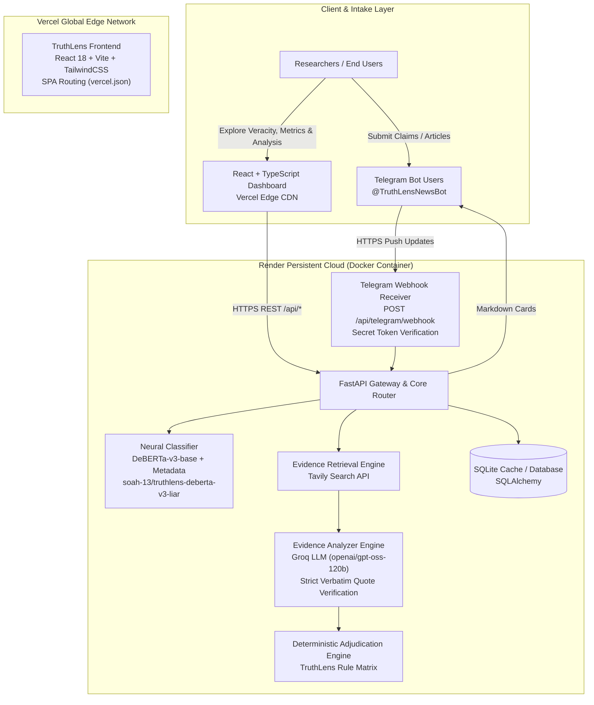
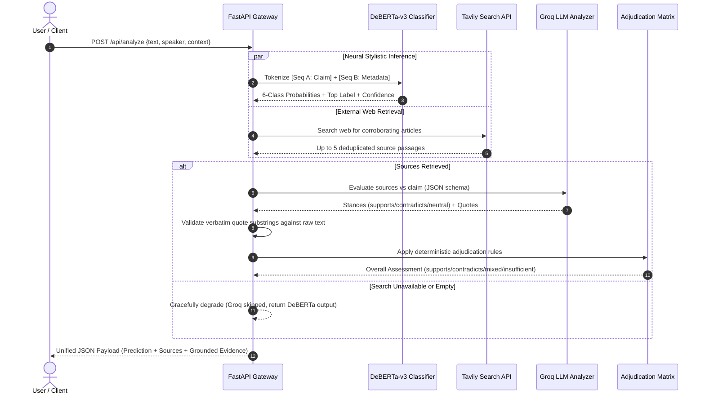

# TruthLens System Architecture Specification

## 1. Executive Architectural Overview

**TruthLens** is an academic engineering and research platform designed to automate fake news detection and evaluate transformer-based language models on fine-grained factual veracity benchmarks.

The system decouples data intake, neural claim classification, external evidence retrieval, grounded LLM relationship analysis, and user visualization into modular, resilient subsystems:

---

## 2. End-to-End Verification Pipeline

When a user submits a claim through either the React Dashboard or the Telegram Bot, TruthLens processes the statement through three parallel and sequential validation stages:

---

## 3. Subsystem Specifications

### 3.1 Frontend Subsystem (`/frontend`)
- **Technology**: React 18, TypeScript 5, Vite 5.4, TailwindCSS, Lucide React, Recharts.
- **Hosting**: Deployed on **Vercel** with global edge caching and SPA client-side routing (`vercel.json`).
- **Features**:
  - **Overview Dashboard**: System health indicator, LIAR benchmark summary cards, live model metrics.
  - **Interactive News Analysis**: Dedicated claim verification interface with optional speaker and context inputs, 6-class probability distribution bars, model confidence badge, clickable source links, and academic disclaimer.
  - **Resilient Degradation**: If external search or LLM analysis is unavailable or fails, neural veracity predictions remain visible and functional.
  - **Environment Configuration**: Configured dynamically via `VITE_API_BASE_URL`.

### 3.2 Backend Application Subsystem (`/backend`)
- **Technology**: Python 3.10+, FastAPI, Uvicorn, Pydantic v2, Pydantic-Settings.
- **Hosting**: Deployed on **Render** as a dedicated persistent Docker container (`Dockerfile`, `render.yaml`).
- **Core Endpoints**:
  - `GET /` — Service discovery and endpoint registry.
  - `GET /api/health` — Application health, database connectivity, and DeBERTa model initialization state.
  - `POST /api/predict` — Pure DeBERTa-v3 6-class neural classification.
  - `POST /api/analyze` — Unified tripartite pipeline: DeBERTa inference + Tavily web retrieval + Groq LLM grounded evidence analysis.
  - `GET /api/model/metrics` — LIAR benchmark evaluation performance.
  - `POST /api/telegram/webhook` — Telegram webhook receiver with header authentication.

### 3.3 Neural Inference Subsystem
- **Model Checkpoint**: Fine-tuned `microsoft/deberta-v3-base` sequence classifier (`soah-13/truthlens-deberta-v3-liar`).
- **Architecture**: Encoder-only Transformer with Disentangled Attention and Enhanced Mask Decoder trained via Replaced Token Detection (RTD).
- **Benchmark Dataset**: LIAR Benchmark (Wang, ACL 2017) — 12,836 annotated political statements.
- **Input Representation**: Sentence-Pair encoding:
  $$\text{Input} = [\text{CLS}] \text{ Statement } [\text{SEP}] \text{ Speaker: } \langle\text{speaker}\rangle \text{ | Context: } \langle\text{context}\rangle [\text{SEP}]$$
- **Output Labels**: Canonical 6-class truthfulness scale (`pants-fire`, `false`, `barely-true`, `half-true`, `mostly-true`, `true`).
- **Performance**: 29.52% Test Accuracy, 29.62% Test Macro-F1 (state-of-the-art across all TruthLens experiments).

### 3.4 Grounded Evidence Synthesis Subsystem
- **Tavily Search API**: Retrieves up to 5 real-time, deduplicated external news articles and content excerpts without algorithmic veracity bias.
- **Groq LLM Engine (`openai/gpt-oss-120b`)**: Evaluates each retrieved source independently for stance (`supports`, `contradicts`, `neutral`).
- **Anti-Hallucination Verification**: Verbatim substring search strictly verifies that any evidence quotation supplied by the LLM exists verbatim within the original crawled article passage. Fabricated quotes are stripped.
- **Deterministic Rule Matrix**: Overall assessment (`supports`, `contradicts`, `mixed`, `insufficient_evidence`) is computed by deterministic Python code, never delegated to generative LLM whims.

### 3.5 Telegram Bot Integration Subsystem (`/backend/app/telegram`)
- **Bot Handle**: `@TruthLensNewsBot`
- **Dual Operating Modes**:
  1. **Production Webhooks**: Event-driven HTTPS delivery (`POST /api/telegram/webhook`) secured with `X-Telegram-Bot-Api-Secret-Token`.
  2. **Local Long Polling**: Developer-friendly local execution (`bot/run_bot.py`) via `python-telegram-bot` v20+.
- **Management CLI**: `backend/scripts/register_webhook.py` provides commands to `--register`, inspect `--status`, or `--delete` webhooks without exposing tokens.

---

## 4. Security & Operational Hardening
- **Credential Hygiene**: Credentials (`TELEGRAM_BOT_TOKEN`, `TAVILY_API_KEY`, `GROQ_API_KEY`, `HF_TOKEN`, `TELEGRAM_WEBHOOK_SECRET`) are read exclusively from environment variables.
- **No Credentials in Logs**: `httpx` and application loggers suppress URLs containing sensitive tokens.
- **CORS Architecture**: Configured with explicit origins and regex support (`https://.*\.vercel\.app`) for Vercel preview and production deployments.
- **Automated Test Coverage**: 74 automated unit and integration tests passing (`pytest backend/tests/`).
