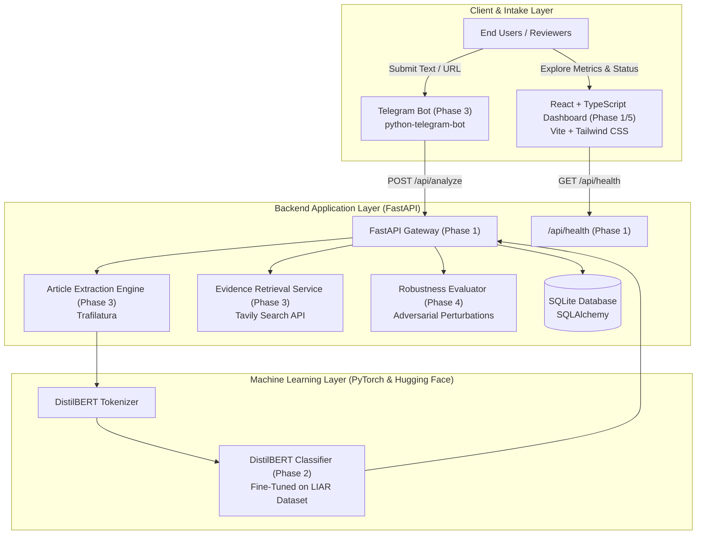
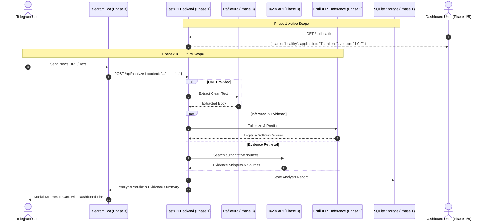

# TruthLens System Architecture Specification

## 1. Executive Architectural Overview

**TruthLens** is an academic engineering platform designed to investigate and combat the spread of misinformation using Natural Language Processing (NLP), automated web evidence retrieval, and systematic adversarial robustness testing.

The system decouples data ingestion, machine learning inference, evidence synthesis, and presentation into modular subsystems communicating over asynchronous REST APIs and HTTP hooks.

---

## 2. Component Responsibilities

### 2.1 Frontend Subsystem (`/frontend`)
- **Technology**: React 18, Vite, TypeScript, Tailwind CSS, Lucide React, Recharts.
- **Responsibilities in Phase 1**:
  - Render a responsive, research-oriented dark SaaS dashboard.
  - Establish a central API client communicating with the backend over HTTP.
  - Dynamically poll and display the backend connection state (`Backend Connected` vs `Backend Disconnected`).
  - Provide structured placeholders for metrics, recent analyses, and adversarial robustness benchmarks without displaying fabricated metrics.
- **Future Responsibilities (Phases 3 & 5)**:
  - Display live feeds of verified articles submitted via Telegram.
  - Visualize prediction confidence distributions and evidence sources.
  - Render comparative robustness radar/bar charts (clean vs. perturbed accuracy, invariance scores).

### 2.2 Backend Subsystem (`/backend`)
- **Technology**: Python 3.10/3.11, FastAPI, Uvicorn, Pydantic v2, SQLAlchemy 2.0, SQLite.
- **Responsibilities in Phase 1**:
  - Expose application discovery at `GET /` and system health at `GET /api/health`.
  - Provide interactive OpenAPI / Swagger documentation at `/docs`.
  - Enforce CORS policy allowing requests from `http://localhost:5173`.
  - Manage database connectivity via SQLAlchemy without premature schema overhead.
  - Provide structured exception handling and application logging.
- **Future Responsibilities (Phases 2, 3, 4)**:
  - Host model inference pipelines and batch prediction endpoints.
  - Orchestrate Trafilatura body text extraction from user-provided URLs.
  - Query Tavily Search API to assemble real-world factual context for claims.
  - Persist analysis history and robustness experiment records to SQLite.

---

## 3. Future Subsystem Integrations

### 3.1 Machine Learning Model Integration (Phase 2)
- **Model Choice**: `distilbert-base-uncased` (66M parameters). DistilBERT provides ~97% of BERT's performance with a 40% reduction in size and 60% faster inference latency, making it optimal for rapid turnaround in interactive detection.
- **Dataset**: LIAR benchmark dataset comprising 12,836 short statements categorized across 6 degrees of truthfulness (`pants-fire`, `false`, `barely-true`, `half-true`, `mostly-true`, `true`), mapped to binary (Real vs. Fake) and multi-class classification heads.
- **Communication Flow**:
  1. Input tokens are batched and tokenized using Hugging Face `DistilBertTokenizerFast`.
  2. The model generates logits converted to calibrated probabilities via Softmax.
  3. Prediction labels, confidence scores, and attention weights are returned to the caller.

### 3.2 Telegram Bot Integration (Phase 3)
- **Library**: `python-telegram-bot` (asynchronous runtime).
- **Intake Modalities**:
  - **Raw Text**: Users forward or paste claims/paragraphs directly into chat.
  - **URL Extraction**: Users submit links; the backend runs Trafilatura to extract primary article text while discarding ads and boilerplate.
- **Response Format**: Formatted Telegram Markdown messages with verdict badges (e.g., `[FAKE NEWS - 94% CONFIDENCE]`), supporting evidence summaries, and a deep-link to the TruthLens web dashboard.

### 3.3 Web Evidence Retrieval (Phase 3)
- **Provider**: Tavily Search API.
- **Pipeline**:
  1. Extract core semantic entities and subject-predicate triples from the target claim.
  2. Query Tavily with news-specific filters.
  3. Aggregate top authoritative sources, publication timestamps, and snippet agreements.
  4. Compare extracted snippets with the claim to produce contextual grounding for the user.

### 3.4 Robustness Evaluation Engine (Phase 4)
- **Research Goal**: Deep learning NLP models are often brittle against surface-level textual variations that do not alter human-perceived semantics. TruthLens evaluates model resilience under four perturbation strategies:
  1. **Typographical Noise**: Random character transposition, insertion, deletion, and keyboard neighbor substitutions.
  2. **Synonym Replacement**: Context-aware replacement of non-stopwords using WordNet embeddings.
  3. **Syntactic Paraphrasing**: Sentence restructuring and back-translation perturbations.
  4. **Negation Injection**: Contrastive perturbations to test whether the model is susceptible to "spurious correlation" rather than true logical understanding.
- **Metrics Tracked**:
  - Drop in Macro F1-score between baseline and perturbed evaluation sets.
  - **Prediction Consistency Rate**: Percentage of instances where $f(x) == f(x')$.

---

## 4. Communication & Security Architecture

### 4.1 Cross-Origin Resource Sharing (CORS)
- In Phase 1, the backend explicitly allows cross-origin requests from the local Vite development server:
  - `http://localhost:5173`
  - `http://127.0.0.1:5173`
- Configurable via `CORS_ORIGINS` environment variable in `backend/.env`.

### 4.2 Configuration Isolation
- Backend: Configured via Pydantic v2 `BaseSettings` reading from `.env`.
- Frontend: Configured via Vite environment variable `VITE_API_BASE_URL`.
- Secrets: No API keys or credentials committed to source control; `.env.example` templates define all contract parameters.
