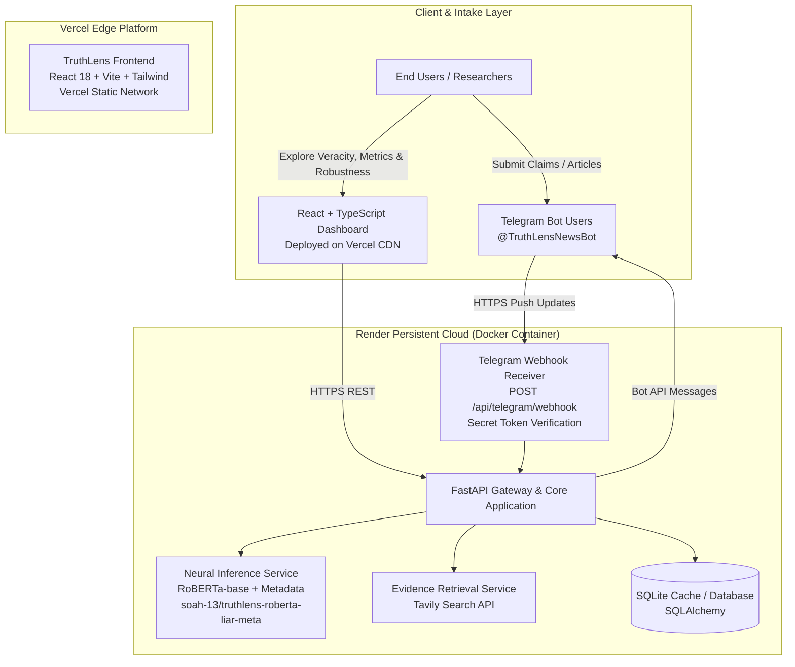

# TruthLens System Architecture Specification

## 1. Executive Architectural Overview

**TruthLens** is an academic engineering and research platform designed to automate fake news detection and evaluate the robustness of transformer-based language models against adversarial textual noise.

The system decouples data intake, neural classification, evidence synthesis, and user visualization into modular subsystems:

---

## 2. Component Specifications

### 2.1 Frontend Subsystem (`/frontend`)
- **Technology**: React 18, TypeScript 5, Vite 5.4, TailwindCSS, Lucide Icons.
- **Hosting**: Deployed on **Vercel** with global edge caching and SPA client-side routing (`vercel.json`).
- **Features**:
  - **Overview Dashboard**: System health indicator, LIAR benchmark summary cards, model metrics visualization.
  - **Interactive News Analysis**: Dedicated claim verification interface with speaker and context fields, 6-class probability distribution bars, model confidence badge, clickable source links, and academic disclaimer.
  - **Resilient Degradation**: If external search is unavailable or fails, neural veracity predictions remain visible.
  - **Environment Configuration**: Configured dynamically via `VITE_API_BASE_URL`.

### 2.2 Backend Application Subsystem (`/backend`)
- **Technology**: Python 3.10+, FastAPI, Uvicorn, Pydantic v2.
- **Hosting**: Deployed on **Render** as a dedicated persistent Docker container (`Dockerfile`, `render.yaml`).
- **Core Endpoints**:
  - `GET /` — Service discovery and endpoint registry.
  - `GET /api/health` — Application health, database connectivity, and RoBERTa model initialization state.
  - `POST /api/predict` — Pure RoBERTa 6-class neural classification.
  - `POST /api/analyze` — Unified inference + Tavily external web search retrieval with URL deduplication.
  - `GET /api/model/metrics` — Evaluation benchmark performance on the LIAR test set.
  - `POST /api/telegram/webhook` — Telegram webhook receiver with header authentication.

### 2.3 Neural Inference Subsystem
- **Model Architecture**: Fine-tuned `roberta-base` sequence classifier (`soah-13/truthlens-roberta-liar-meta`).
- **Dataset**: LIAR Benchmark (12,800+ annotated statements).
- **Metadata Encoding**: Sentence-pair formulation strictly matching Colab training:
  $$\text{Input} = [\text{Statement}] \text{ [SEP] } \text{Speaker: } \langle\text{speaker}\rangle \text{ | Context: } \langle\text{context}\rangle$$
- **Output Labels**: Canonical 6-class truthfulness scale (`pants-fire`, `false`, `barely-true`, `half-true`, `mostly-true`, `true`).

### 2.4 Telegram Bot Integration Subsystem (`/backend/app/telegram`)
- **Bot Handle**: `@TruthLensNewsBot`
- **Dual Operating Modes**:
  1. **Production Webhooks**: Event-driven HTTPS delivery (`POST /api/telegram/webhook`) secured with `X-Telegram-Bot-Api-Secret-Token`.
  2. **Local Long Polling**: Developer-friendly local execution (`bot/run_bot.py`) via `python-telegram-bot`.
- **Management CLI**: `backend/scripts/register_webhook.py` provides commands to `--register`, inspect `--status`, or `--delete` webhooks without exposing tokens.

---

## 3. Security & Operational Hardening
- **Credential Hygiene**: Credentials (`TELEGRAM_BOT_TOKEN`, `TAVILY_API_KEY`, `HF_TOKEN`, `TELEGRAM_WEBHOOK_SECRET`) are read exclusively from environment variables.
- **No Credentials in Logs**: `httpx` and application loggers suppress URLs containing sensitive tokens.
- **CORS Architecture**: Configured with explicit origins and regex support (`https://.*\.vercel\.app`) for Vercel preview and production deployments.
- **Automated Test Coverage**: 58 automated unit and integration tests passing (`pytest backend/tests/`).
